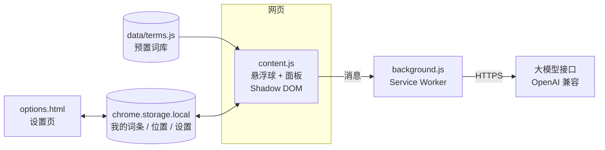

# 💬 营销黑话词典 · 悬浮球（Chrome 扩展）

> 刚进互联网营销行业，文档里全是 CPM、ROI、起量、留资、抓手、闭环……
> 这个扩展在**任意网页**右下角放一个悬浮球，点一下就能查，不用切走去搜。

  

## ✨ 功能

| 功能 | 说明 |
|---|---|
| 📖 **查词典** | 内置 71 条词条，覆盖广告投放、营销指标、内容种草、用户增长、职场黑话 5 类，离线可用 |
| 🖱️ **划词即查** | 在网页上选中一个词，再点悬浮球，搜索框会自动带上这个词 |
| 🤖 **AI 查词** | 词典里没有的词可以一键问 AI，返回释义、英文、例句和分类 |
| ✅ **一键收录** | AI 的解释确认没问题后，点一下就收进「我的词典」，下次直接能搜到 |
| 🎯 **可拖动** | 悬浮球可以拖到任意位置，位置会记住；也可以隐藏，点工具栏图标唤回 |
| 🔒 **数据在本地** | 词条和 API Key 只保存在本机浏览器，没有自己的服务器 |

## 🚀 安装（约 1 分钟）

1. 点本页右上角绿色的 **Code → Download ZIP**，解压到一个**固定的文件夹**（删掉文件夹扩展就会失效）
2. 在 Chrome 地址栏输入 `chrome://extensions/` 并回车
3. 打开右上角的「**开发者模式**」
4. 点左上角「**加载已解压的扩展程序**」，选中刚解压的文件夹
5. 打开任意网页，右下角会出现 💬 悬浮球

> 装扩展之前已经打开的网页需要刷新一下，或者直接点工具栏里的扩展图标。

## 🤖 配置 AI 查词（可选）

不配置也能用内置词典。想用 AI 查词，需要自己准备一个大模型的 API Key：

1. 在 `chrome://extensions/` 找到本扩展，点「详细信息 → 扩展程序选项」
2. 填写接口地址、模型名和 API Key，点「保存」，并在浏览器弹窗中允许访问该接口
3. 点「测试一下」确认可用

支持任意**兼容 OpenAI 格式**的接口，例如：

| 服务 | 接口地址 | 模型名 |
|---|---|---|
| DeepSeek | `https://api.deepseek.com/v1` | `deepseek-chat` |
| 通义千问 | `https://dashscope.aliyuncs.com/compatible-mode/v1` | `qwen-plus` |
| Kimi | `https://api.moonshot.cn/v1` | `moonshot-v1-8k` |

## 🧱 技术实现



几个设计点：

- **Shadow DOM 隔离样式**：悬浮球要注入到任意网页，用 Shadow DOM 包起来，页面的 CSS 影响不到它，它也不会弄乱页面。
- **AI 请求放在 Service Worker 里发**：内容脚本运行在网页的源上，直接请求会被跨域限制拦住，所以统一交给后台发。
- **权限按需申请**：安装时不申请任何网站的访问权限；只有用户在设置页保存接口地址时，才申请访问那一个域名。
- **注入兜底**：扩展安装前已打开的标签页不会自动注入脚本。点工具栏图标时会先探测页面里有没有悬浮球，没有就手动注入一次。
- **搜索排序**：词条完全匹配排最前，其次是前缀匹配、词条包含，最后才是只在释义里出现的。
- **AI 返回容错**：要求模型只返回 JSON，并从返回内容里截取 JSON 部分再解析；分类不在预设范围内时归到默认分类。
- **零依赖**：纯原生 JavaScript，没有打包步骤，下载即可加载。

## 📁 目录结构

```
marketing-jargon-ball/
├── manifest.json     # 扩展配置（Manifest V3）
├── content.js        # 悬浮球和面板：搜索、分类、划词、拖动、收录
├── background.js     # 后台：AI 查词、工具栏图标、注入兜底
├── options.html/js   # 设置页：AI 接口配置、导出 / 清空我的词条
└── data/terms.js     # 预置词库
```

## ✏️ 想加自己的词条

- **最简单**：在悬浮球里搜这个词 → 问 AI → 收进我的词典。
- **改预置词库**：打开 `data/terms.js`，照着已有格式加一行：

```js
{ term: '起量', termEn: 'Scale Up', category: 'ad', definition: '……', examples: ['……'] },
```

`category` 可选：`ad` 广告投放 / `metric` 营销指标 / `content` 内容种草 / `growth` 用户增长 / `work` 职场黑话。

## ❓ 常见问题

**看不到悬浮球？**
先刷新页面；还没有就点一下工具栏里的扩展图标。`chrome://` 开头的页面和扩展商店不允许任何扩展注入，换一个普通网页试。

**AI 查词报「网络请求失败」？**
到设置页重新点一次「保存」，在弹窗里允许访问接口域名；再检查接口地址有没有写错。

**我的词条存在哪？**
存在本机浏览器的扩展存储里，换电脑不会同步。可以在设置页导出为 JSON 备份。

## 📝 说明

- 预置词条是我在营销岗位实习期间整理的常见术语，释义按行业通用口径写，具体指标口径以各平台官方定义为准。
- 灵感来自实习时用过的一款团队内部黑话词典工具。本项目的代码、词库和文案均为独立编写，AI 能力改为接入公开的大模型接口，不含任何公司内部数据或接口。

## 📄 License

MIT
